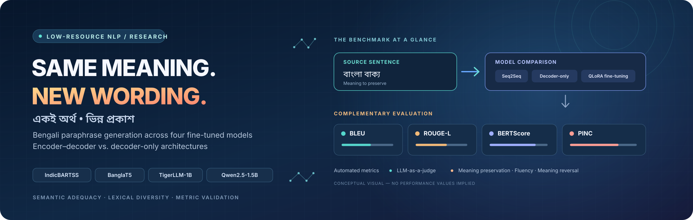
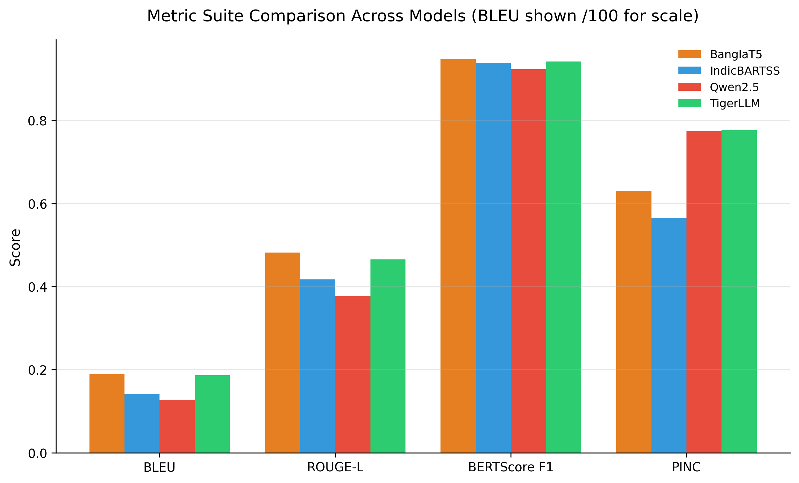
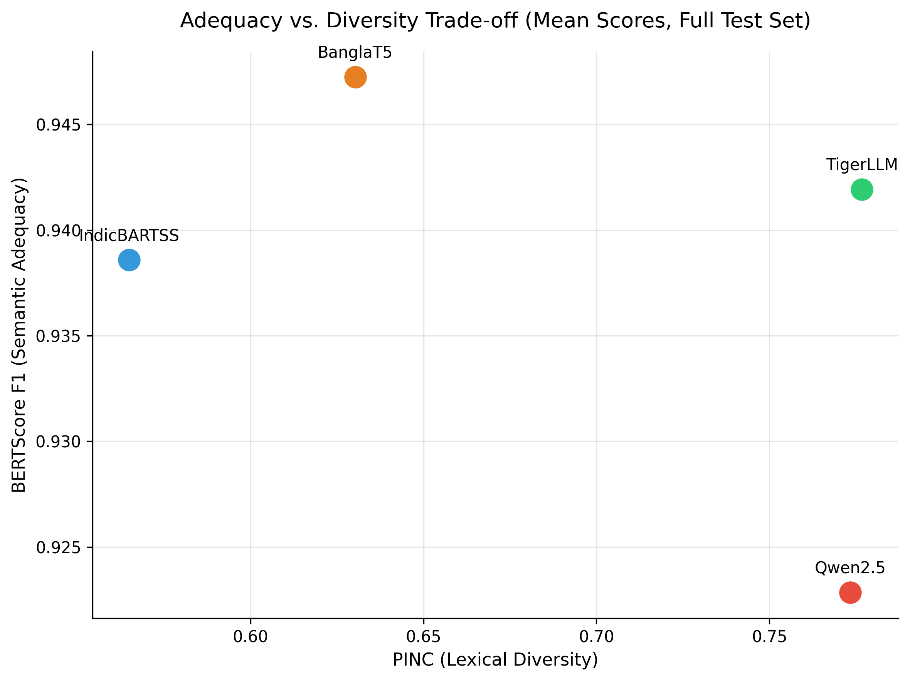
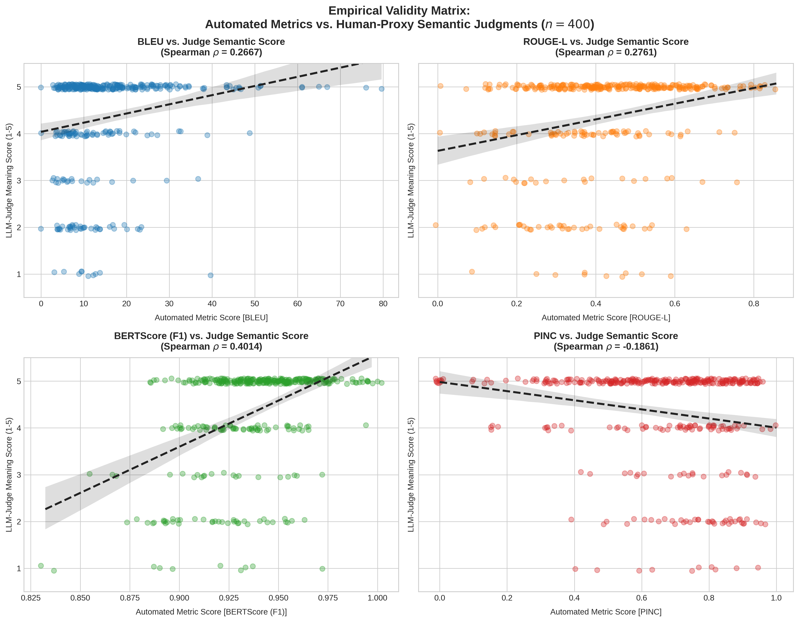
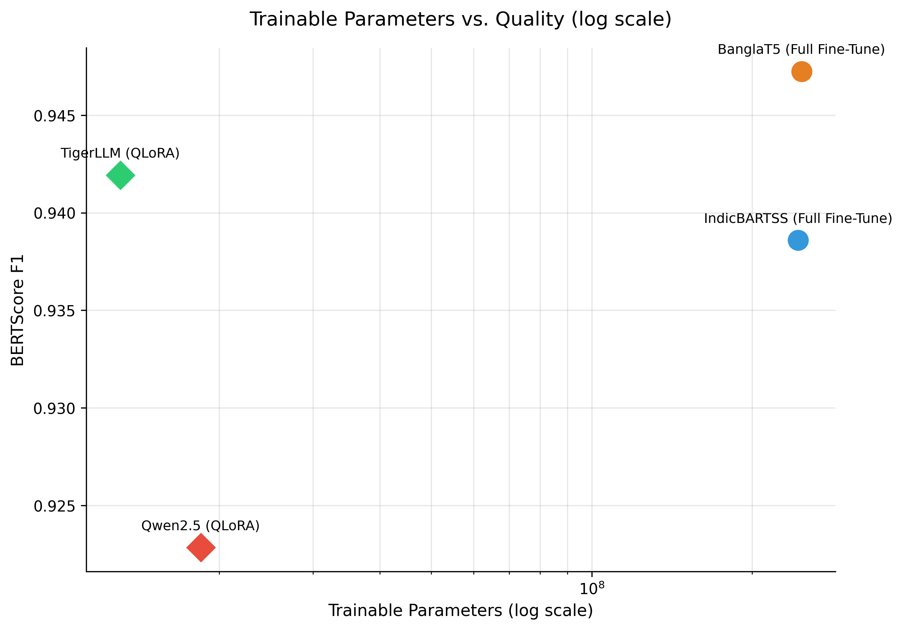
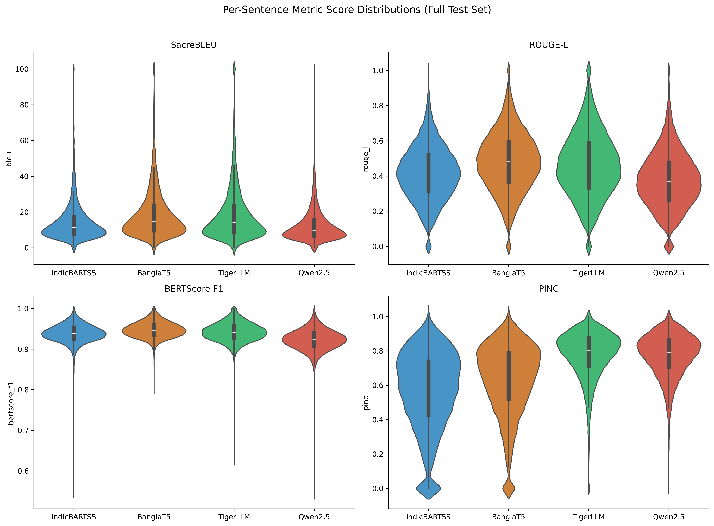
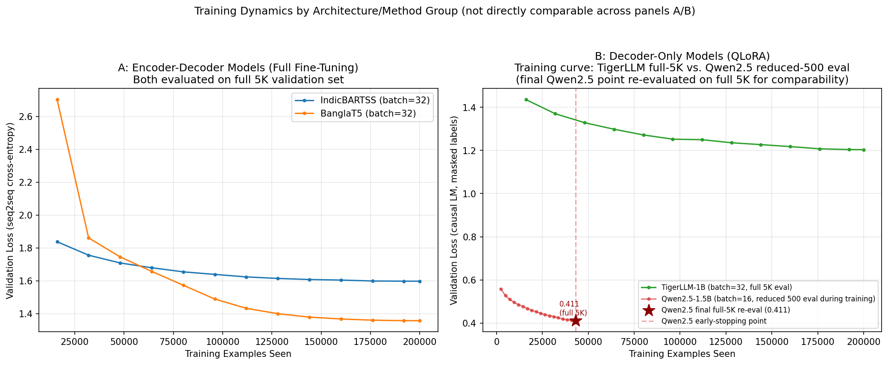
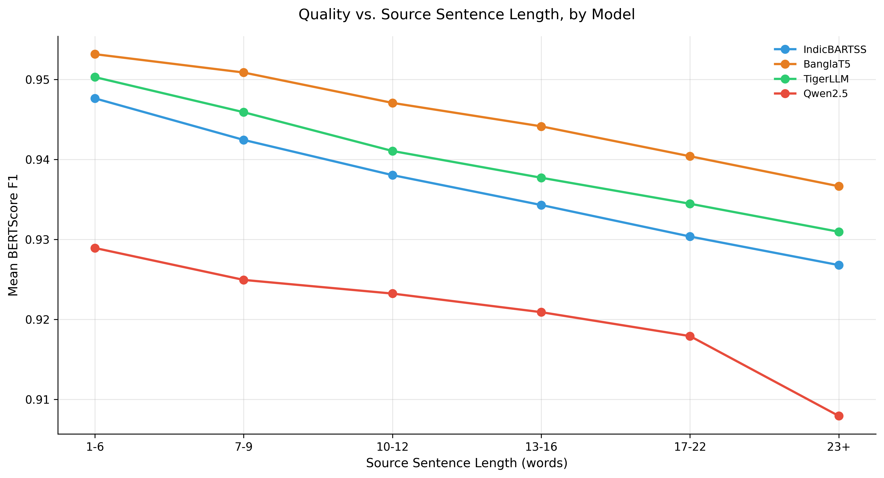

<p align="center">
  
</p>


# Bengali Paraphrase Generation: A Comparative Study of Encoder-Decoder and Decoder-Only Architectures

[](https://www.python.org/)
[](https://pytorch.org/)
[](https://huggingface.co/AvinabhDutta-Dev)
[](https://huggingface.co/docs/peft)
[](https://github.com/AvinabhDutta-Dev/bangla-paraphrase-benchmark)

## Introduction

This project benchmarks four fine-tuned language models — two encoder-decoder (IndicBARTSS, BanglaT5) and two decoder-only QLoRA-tuned models (TigerLLM-1B, Qwen2.5-1.5B-Instruct) — on Bengali paraphrase generation, using the [BanglaParaphrase](https://arxiv.org/abs/2210.05109) dataset.

Beyond standard automated metrics (BLEU, ROUGE-L, BERTScore, and PINC), this project investigates how well these metrics reflect actual paraphrase quality in a low-resource language. An LLM-as-a-judge evaluated a symmetric subset of 100 source sentences across four model outputs, producing 400 model-output judgments. The evaluation considers semantic meaning preservation, fluency, and meaning reversal, and compares judge assessments with automated metric scores to identify where surface-level overlap diverges from perceived semantic quality.

## Table of Contents

- [Introduction](#introduction)
- [Key Results](#key-results)
- [Tech Stack](#tech-stack)
- [Evaluation Pipeline](#evaluation-pipeline-flow)
- [Project Structure](#project-structure)
- [Setup and Reproduction](#setup)
- [Data Pipeline and Model Checkpoints](#data-pipeline)
- [Running the Notebooks](#running)
- [Notes and Evaluation Caveats](#notes)
- [Licensing and Citation](#licensing--citation)

## Key Results

The benchmark compares four fine-tuned models for Bengali paraphrase generation using automated metrics and a separate LLM-as-a-judge analysis.

### Automated Evaluation

| Model | BLEU | ROUGE-L | BERTScore F1 | PINC |
|---|---:|---:|---:|---:|
| BanglaT5 | 18.88 | 0.4820 | 0.9472 | 0.6303 |
| TigerLLM-1B (QLoRA) | 18.69 | 0.4655 | 0.9419 | 0.7767 |
| IndicBARTSS | 14.07 | 0.4173 | 0.9386 | 0.5650 |
| Qwen2.5-1.5B (QLoRA) | 12.71 | 0.3774 | 0.9228 | 0.7734 |

### Main Findings

- **BanglaT5** achieved the highest BLEU, ROUGE-L, and BERTScore F1 among the four evaluated models.
- **TigerLLM-1B** achieved the highest PINC score, indicating greater lexical difference from the source under this metric.
- The LLM-as-a-judge analysis examines meaning preservation, fluency, and meaning reversal to investigate whether automated metrics reflect perceived paraphrase quality.
- The results illustrate why paraphrase generation should be evaluated using multiple complementary metrics rather than BLEU alone.

**Evaluation scope:** These results apply to the benchmark's evaluated test distribution and experimental settings. They should not be interpreted as a universal ranking across all Bengali text or paraphrase-generation tasks.

## Results Visualizations

### 1. Automated Metric Comparison



BanglaT5 achieves the highest BLEU, ROUGE-L, and BERTScore F1 scores, while TigerLLM achieves the highest PINC score among the evaluated models.

### 2. Semantic Adequacy vs. Lexical Diversity



This figure illustrates the trade-off between semantic adequacy, measured using BERTScore F1, and lexical diversity, measured using PINC.

### 3. Automated Metric Validity



The analysis compares automated metric scores with LLM-judge assessments of semantic meaning preservation across 400 model-output judgments. BERTScore shows a stronger rank correlation with judge-assessed meaning preservation than BLEU and ROUGE-L in this evaluation, while PINC shows a small negative correlation.

### 4. Parameter Efficiency vs. Quality



This comparison highlights the relationship between the number of trainable parameters and semantic similarity for full fine-tuning and QLoRA-based approaches.

### 5. Per-Sentence Score Distributions



These distributions show variation in model performance across individual test examples, complementing the aggregate scores in the results table.

### 6. Training-Loss Curves



The training curves provide additional context for comparing model convergence and training behavior.

### 7. Length-Stratified Performance



This analysis examines how evaluation performance varies with input length rather than relying solely on overall averages.

## Tech Stack

| Category | Tools / Libraries |
|---|---|
| Language |  Python 3 |
| Model training | `transformers`, `peft` (QLoRA/LoRA), `bitsandbytes`,  PyTorch |
| Base models |  IndicBARTSS, BanglaT5, TigerLLM-1B-it, Qwen2.5-1.5B-Instruct |
| Evaluation metrics | `sacrebleu`, `rouge-score`, `bert-score`, custom PINC implementation |
| LLM-as-a-Judge | Google `google-genai` SDK,  Gemini 3.5 Flash-Lite |
| Data handling |  `pandas`, Parquet (via `pyarrow`) |
| Visualization | `matplotlib` |
| Text normalization | `csebuetnlp/normalizer`, `sentencepiece` |
| Environment |  Google Colab (GPU: T4),  Google Drive (persistent storage) |

## Evaluation Pipeline Flow

```
BanglaParaphrase Dataset (419,963 / 23,331 / 23,332 train/val/test)
        |
        v
[01] Preprocessing & Cleaning
     train_subset_100k / validation_subset_5k / test_clean
        |
        v
[02-04b] Fine-tuning (per model)
   - IndicBARTSS   -> full fine-tune, seq2seq
   - BanglaT5      -> full fine-tune, seq2seq
   - TigerLLM-1B   -> QLoRA, causal LM
   - Qwen2.5-1.5B  -> QLoRA, causal LM (+ full-5K re-eval for comparability)
        |
        v
[05a/05b] Generation on the untouched 23,332-example test set (all 4 models)
        |
        v
[06] Automated Metrics
     BLEU - ROUGE-L - BERTScore (BanglaBERT) - PINC
        |
        v
[07] LLM-as-a-Judge Validation (400-pair symmetric subset)
   - Semantic meaning preservation (1-5)
   - Fluency (1-5)
   - Meaning reversal (binary)
   - Correlation vs. automated metrics + systematic error matrix
```

## Project Structure

```
bengali-paraphrasing/
├── README.md
├── requirements.txt
├── .gitignore
├── LICENSE
│
├── notebooks/
│   ├── 01_preprocessing.ipynb
│   ├── 02_train_indicbartss.ipynb
│   ├── 03_train_banglat5.ipynb
│   ├── 04_train_tigerllm_qlora.ipynb
│   ├── 04b_train_qwen_qlora.ipynb
│   ├── 04b_qwen_full_eval.ipynb
│   ├── 05a_generate_seq2seq.ipynb
│   ├── 05b_generate_decoder_llms.ipynb
│   ├── 06_compute_metrics.ipynb
│   └── 07_metric_validation_and_error_analysis.ipynb
│
├── outputs/
│   ├── combined_loss_curves_panels_v2.png
│   ├── combined_loss_curves_panels_v2.svg
│   ├── generations/
│   ├── llm_judge/
│   │   ├── bengali_paraphrase_final_evaluated_matrix.csv
│   │   ├── metric_validity_correlation_matrix.png
│   │   └── metric_validity_correlation_matrix.svg
│   └── metrics/
│       ├── adequacy_diversity_scatter.png (+ .svg)
│       ├── distribution_violin_plots.png (+ .svg)
│       ├── length_stratified_performance.png (+ .svg)
│       ├── metric_suite_bar_chart.png (+ .svg)
│       └── param_efficiency_scatter.png (+ .svg)│
└── docs/
    └── model_documentation/
        ├── seq2seq_model_documentation.json
        └── decoder_model_documentation.json
```

## Setup

```bash
git clone https://github.com/AvinabhDutta-Dev/bangla-paraphrase-benchmark.git
cd bangla-paraphrase-benchmark
pip install -r requirements.txt
pip install git+https://github.com/csebuetnlp/normalizer
```

The second `pip install` is required separately — `csebuetnlp/normalizer` (used for BanglaT5's text preprocessing) isn't published on PyPI, so it can't be listed inside `requirements.txt` and must be installed directly from its GitHub source.

Notebooks were run on **Google Colab** (free-tier T4 GPU) with Google Drive mounted for persistent storage across sessions. To reproduce:

1. Upload the `notebooks/` folder to Google Drive.
2. Update `PROJECT_ROOT` at the top of each notebook to your own Drive path.
3. `processed_data/` in this repo already contains the preprocessed train/validation/test subsets — `01_preprocessing.ipynb` only needs to be re-run if you want to regenerate them from the original BanglaParaphrase dataset yourself.
4. A `GEMINI_API_KEY` Colab secret is required for Notebook 07 (LLM-judge step) — get one from [Google AI Studio](https://aistudio.google.com/).
5. Trained model weights are not included in this repo — download them from the Hugging Face Hub links in the Data Pipeline section below if you want to skip training and go straight to generation/evaluation.

## Data Pipeline

| Stage | Notebook(s) | Output | Included in this repo? |
|---|---|---|---|
| Preprocessing | `01_preprocessing.ipynb` | `train_subset_100k`, `validation_subset_5k`, `test_clean` (Parquet) | ✅ Yes — see `processed_data/` |
| Training | `02`–`04b` | Per-model checkpoints (`best_model/`) | ❌ No — hosted on Hugging Face Hub (see below) |
| Generation | `05a`, `05b` | Per-model generations on the full test set (Parquet) | ✅ Yes — see `outputs/generations/` |
| Metrics | `06_compute_metrics.ipynb` | `all_metrics_long_format.parquet`, `model_summary.csv` | ✅ Yes — see `outputs/metrics/` |
| Validation | `07_metric_validation_and_error_analysis.ipynb` | `bengali_paraphrase_final_evaluated_matrix.csv` | ✅ Yes — see `outputs/llm_judge/` |

> **Note:** `processed_data/` contains derived subsets of the original [BanglaParaphrase](https://huggingface.co/datasets/csebuetnlp/BanglaParaphrase) dataset (419,963/23,331/23,332 train/val/test), included here for full reproducibility. The original, complete dataset and its license/citation terms are maintained at the link above — please refer to it as the canonical source rather than this repo's derived subsets.
>
> Trained model weights are not stored in this repository (checkpoints are multi-GB and unsuited to Git). They are hosted on **Hugging Face Hub** instead:
>
> | Model | Hugging Face Hub |
> |---|---|
> | IndicBARTSS (full fine-tune) | [AvinabhDutta-Dev/bangla-paraphrase-indicbartss](https://huggingface.co/AvinabhDutta-Dev/bangla-paraphrase-indicbartss) |
> | BanglaT5 (full fine-tune) | [AvinabhDutta-Dev/bangla-paraphrase-banglat5](https://huggingface.co/AvinabhDutta-Dev/bangla-paraphrase-banglat5) |
> | TigerLLM-1B (QLoRA, merged) | [AvinabhDutta-Dev/bangla-paraphrase-tigerllm-qlora](https://huggingface.co/AvinabhDutta-Dev/bangla-paraphrase-tigerllm-qlora) |
> | Qwen2.5-1.5B (QLoRA, merged) | [AvinabhDutta-Dev/bangla-paraphrase-qwen2.5-qlora](https://huggingface.co/AvinabhDutta-Dev/bangla-paraphrase-qwen2.5-qlora) |

Each repo can be loaded directly with `transformers` — no need to clone this GitHub repo or retrain anything:

```python
from transformers import AutoModelForCausalLM, AutoTokenizer

model = AutoModelForCausalLM.from_pretrained("AvinabhDutta-Dev/bangla-paraphrase-qwen2.5-qlora")
tokenizer = AutoTokenizer.from_pretrained("AvinabhDutta-Dev/bangla-paraphrase-qwen2.5-qlora")
```

See each model's card for the exact loading pattern (IndicBARTSS and BanglaT5 are seq2seq models with different loading code than the two causal-LM models above).

## Running

Each notebook is self-contained and numbered in execution order. Run sequentially:

```
01 -> 02, 03, 04, 04b (any order - independent models) -> 05a, 05b -> 06 -> 07
```

Notebooks `05b` and `07` include resume-safe checkpointing, since free-tier Colab GPU sessions are time-limited — re-running a notebook after a disconnect will resume from the last saved checkpoint rather than restart.

## Requirements

See `requirements.txt`. Key packages:

```
transformers
peft
bitsandbytes
accelerate
sentencepiece
sacrebleu
rouge-score
bert-score
google-genai
pandas
pyarrow
matplotlib
```

## Notes

- **Metric caveats:** BLEU/ROUGE-L are known to correlate poorly with paraphrase quality specifically (Shen et al., 2022) — see Notebook 07 for an empirical validation of this on this dataset.
- **Eval-set consistency:** Qwen2.5's training-time validation loss was logged against a reduced 500-example subset for efficiency; a full-5K re-evaluation (`04b_qwen_full_eval.ipynb`) confirms this did not meaningfully bias the reported number (0.4113 vs. 0.4109).
- **Tokenizer fix:** `rouge-score`'s default tokenizer silently strips non-ASCII characters, producing invalid ROUGE-L=0 scores for Bengali text. This repo's Notebook 06 uses a custom whitespace tokenizer to fix this — worth knowing if reusing this code for other non-Latin-script languages.
- **BERTScore model:** uses `csebuetnlp/banglabert` (12-layer ELECTRA) rather than a generic multilingual model, for comparability with the original BanglaParaphrase paper's own benchmarks.

## Licensing & Citation

### Code License
The evaluation pipelines, fine-tuning scripts, and LLM-as-a-judge code are licensed under the **MIT License** - see the [LICENSE](LICENSE) file for details.

### Dataset, Benchmark Results & Preprint License
The 400-pair symmetric evaluation dataset, metric comparison data, and preprint text are licensed under a [Creative Commons Attribution 4.0 International License (CC-BY-4.0)](https://creativecommons.org). 

If you use this benchmark pipeline, the curated evaluation subset, or our findings in your research, please cite our study:

### Citation

If you use this benchmark, its evaluation pipeline, or its findings, please cite the project repository:

```text
AvinabhDutta-Dev. Bengali Paraphrase Generation:
A Comparative Study of Encoder-Decoder and Decoder-Only Architectures.
GitHub repository:
https://github.com/AvinabhDutta-Dev/bangla-paraphrase-benchmark
```

For work involving the underlying dataset or pretrained models, please also cite the original resources linked in this README and the corresponding Hugging Face model cards.

A formal BibTeX citation for this study will be added when its bibliographic details are finalized.
